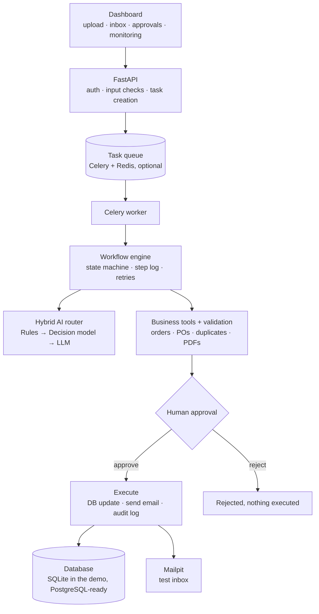

# SMEFlow AI

**Business process automation with AI: an email or a PDF invoice comes in, the system classifies and extracts it, checks it against company data, a person approves, and only then does the system update the database and send the reply.**

A Portfolio MVP showing how AI is wired into a real business process (REST API, database, background jobs, human approval gate), not a chatbot.

> The full source is in a private repository. This page covers what it does and how it is built. Happy to walk through the code live in an interview.

## Skills this project shows

| Area | What is in the project |
|---|---|
| **Workflow automation** | Two end-to-end workflows on an explicit state machine, step log, retry of only the failed step, idempotent handlers, outbox for outgoing email |
| **AI integration** | Hybrid routing (rules → decision model → LLM), OpenAI Decisions API for cheap classification, structured JSON output for extraction, emails and PDFs treated as untrusted input |
| **Trusting AI safely** | The model proposes, Python verifies: arithmetic, purchase-order match, duplicates and order ownership are recomputed from the database, never taken from the model |
| **Backend** | FastAPI, SQLAlchemy, Alembic migrations, Celery worker mode, PDF parsing (PyMuPDF) and generation |
| **Security** | Login, roles enforced on the server, tenant isolation (another company's record is a 404), outbound email allow-list, audit log |
| **Frontend** | React + TypeScript + Tailwind: upload, inbox, approval review with the PDF beside the extracted fields, workflow timeline |
| **Testing** | 54 automated tests that run offline; OpenAI adapters tested against a fake client; tests fail if the ownership or blocking-issue checks are removed |

## Demo (3 short videos)

| | What you see |
|---|---|
| **1. Invoice processing** [▶ TODO video link]() | Upload a supplier PDF → fields extracted → checked against the purchase order and for duplicates → reviewer approves → invoice recorded and confirmation email sent |
| **2. Email-to-action** [▶ TODO video link]() | Customer emails "send me invoice for ORD-1024" → classified → sender and order ownership verified → PDF + draft reply → reviewer verifies recipient and order → approved → arrives in the inbox. Someone else's order is refused |
| **3. Problems caught before approval** [▶ TODO video link]() | Duplicate invoice blocked, amount mismatch shown with both numbers, missing PO picked from known purchase orders and verified by the reviewer, then re-validated |

> **About the demo.** To keep the videos short, everything is shown with a single account (an admin of one demo company). The system itself separates companies and roles: other companies cannot see this data, and staff accounts can review but not approve. The checks, approval rules and workflow steps shown here are examples for a small business, and they can be adjusted to a company's own process and details.

## Dashboard

Workflow counts by outcome, items waiting for approval, how often a human reviews, how emails were routed (rules, decision model, LLM), and how many duplicates and access attempts were blocked.

## How it fits together

**Principle:** the model understands and drafts; Python executes. The AI can propose an action, but it cannot write to the database or send mail. Every real action passes server-side checks and a human approval first.

## The workflows: what is automated, what stays human

**1. Invoice processing**

| Step | Done by |
|---|---|
| Upload the supplier PDF, parse text | System |
| Extract supplier, invoice number, PO, dates, line items, totals (with source page) | AI |
| Recompute arithmetic, match the purchase order, detect duplicates | Python, against the database |
| Resolve blocking issues (e.g. pick the right PO from the known ones and verify it against the PDF) | **Reviewer** |
| Approve | **Reviewer** |
| Record the invoice, send the confirmation email, write the audit log | System |

**2. Email-to-action** (customer asks for an invoice copy)

| Step | Done by |
|---|---|
| Classify the email: rules first, then the decision model, then the LLM only if unsure | System / AI |
| Find the order number, match the sender to a known customer, check the order belongs to that customer | Python, against the database |
| Generate the invoice PDF and draft the reply | System / AI |
| Verify recipient and order, approve | **Reviewer** |
| Send the email (once only) and write the audit log | System |

An order number in an email proves nothing, so ownership is always checked against the database before any document is produced.

## Hybrid AI routing

Cheapest layer that is sure enough decides; each decision records which layer ran and what it cost.

| Layer | Handles | Cost |
|---|---|---|
| Rules | Unmistakable patterns (e.g. an order number plus "invoice") | none |
| Decision model | Cheap classification and routing | low |
| LLM | Ambiguous or paraphrased requests, extraction, drafting | highest |

A routing accuracy comparison (rules only vs decision vs LLM only vs hybrid) has not been measured yet; see known limits in the [technical notes](docs/tech-notes.md#known-limits).

## Reliability and safety

- **Explicit state machine**: `CREATED → QUEUED → PROCESSING → VALIDATING → PENDING_APPROVAL → APPROVED → EXECUTING → COMPLETED`, plus `FAILED / REJECTED / RETRYING`. Illegal jumps are refused.
- **Retry only what failed**: finished steps are skipped when a run is retried.
- **Idempotent**: redelivered queue messages are no-ops; an outbox key guarantees an approved email is sent once.
- **Tenant isolation**: every query is scoped to the caller's company; another company's record looks like a 404.
- **Server-side authorization**: roles and workflow state are re-checked on every approve/reject/edit call.
- **Outbound mail allow-list**: only known customer or supplier addresses can receive email.
- **Audit trail** of who did what, and an AI cost log per call.

## Tech stack

Python · FastAPI · SQLAlchemy · Alembic · Celery · PyMuPDF · OpenAI API · pytest · Mailpit · React + TypeScript + Tailwind

The demo runs locally on SQLite with two commands (backend, Mailpit). The repo also contains a PostgreSQL migration, a Celery/Redis worker mode and a Docker Compose file; those are included but are not part of the demo and have not been run end to end.

## Status

- Backend, both workflows, approval gate, auth and analytics: working, with 54 automated tests and an end-to-end run over real SMTP.
- AI providers sit behind adapter interfaces: deterministic mocks for tests, OpenAI models for the live demo (verified with a live check of the decision model, the LLM, extraction and drafting); see [docs/tech-notes.md](docs/tech-notes.md#ai-providers).
- Web UI (React + TypeScript): dashboard, document upload with drag and drop, email inbox, approval review with PDF side by side, workflow timeline.

## Documentation

- [Technical notes](docs/tech-notes.md): state machine, data model, API, design decisions, testing

---
Built by TODO your name · TODO contact link
