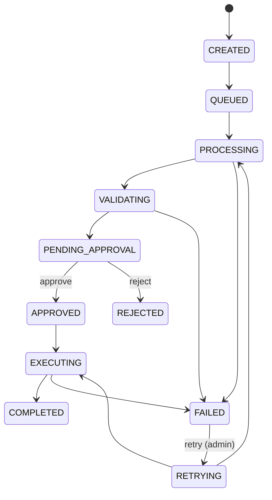
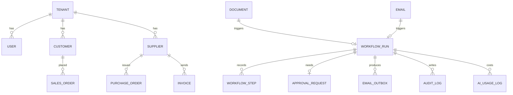

# Technical notes

## Workflow state machine

Each run is a list of steps. Every step stores its engine (`python`, `rules`, `decision` or `llm`), duration, error code and retry count, so the UI can show what ran, how long it took and which layer made each AI decision. A retry re-runs only the failed step.

## Data model

Every business table carries `tenant_id`. A unique constraint on (company, supplier, invoice number) is the last line of defence against duplicate invoices.

## API

| Method | Endpoint | Purpose |
|---|---|---|
| POST | `/api/auth/login` | Get a token |
| POST | `/api/documents` | Upload an invoice PDF, start a workflow |
| GET | `/api/documents`, `/api/documents/{id}`, `/api/documents/{id}/file` | List, extracted data, original PDF |
| POST | `/api/emails/import` | Import a customer email, start a workflow |
| GET | `/api/emails` | Inbox with classification and workflow status |
| GET | `/api/workflows`, `/api/workflows/{id}` | List; detail with step timeline and routing |
| POST | `/api/workflows/{id}/retry` | Retry a failed workflow (admin) |
| GET | `/api/approvals`, `/api/approvals/{id}` | Pending approvals with proposed action and issues |
| POST | `/api/approvals/{id}/approve` / `reject` / `edit` | Decide or correct (admin) |
| GET | `/api/analytics/summary` | Success rate, routing mix, cost, duplicates blocked |
| GET | `/health` | Health check |

Interactive docs are served at `/docs`.

## Design decisions

- **Predefined workflows, AI inside the steps.** The AI selects, extracts and drafts; the sequence of steps is fixed code. That keeps behaviour testable and keeps the model away from anything irreversible.
- **No model-reported confidence.** Whether an extraction is usable is decided by validation rules (arithmetic, purchase order match, duplicates, missing fields), not by a number the model gives itself.
- **Reviewer verification is enforced too.** For customer emails, the approve call is refused unless the reviewer confirmed the recipient and order. The UI shows who sent the email, which customer it matched and whose order it is.
- **Approval is enforced on the server.** The approve endpoint re-checks role, approval status, workflow state and blocking issues. A hidden button is not access control.
- **At-least-once delivery, idempotent handlers.** Queue messages can be redelivered, so each handler only acts when the run is in the expected state, and outgoing email is keyed in an outbox table.
- **PostgreSQL over a document store.** The data is relational (orders, purchase orders, invoices) and needs constraints and joins.
- **Tenant isolation is a data rule, not a container.** Companies are separated by scoped queries and tests, not by one container per customer.

## AI providers

All model calls go through two small interfaces, a *decision adapter* (classify) and an *LLM adapter* (classify, extract invoice fields, draft a reply). The workflow code never imports a provider.

Two implementations exist behind each interface:

- **Mock**: deterministic, free, used by the test suite.
- **OpenAI**: a small, cheap model for the decision layer and a stronger model for extraction and drafting, both configurable.

Notes on the OpenAI adapters:

- The decision layer uses the OpenAI Decisions API: a typed `choice` question returns per-choice probabilities, and the router's confidence is the probability of the chosen value, not the model describing its own certainty. A refusal or unexpected answer reports zero confidence, so the request escalates to the stronger model.
- Extraction and classification use strict JSON-schema output. Emails and PDFs are treated as untrusted data (kept out of the system prompt), and everything the model returns is re-checked by Python: arithmetic, purchase-order match, duplicates, order ownership. A test confirms a model that misreads a total is still caught.
- Provider failures become a named error (`AI_PROVIDER_ERROR`), so the workflow is marked FAILED and the failed step can be retried.
- Token usage and an estimated cost are logged per call.

## Testing

54 automated tests, run without network or paid APIs (the OpenAI adapters are tested against a fake client):

- **Invoice flow**: clean invoice, duplicate, amount mismatch, arithmetic error, missing PO fixed by reviewer, unknown supplier, reject, staff vs admin, retry of only the failed step
- **Email flow**: end to end with real attachment, second approval cannot resend, redelivered tasks do not resend, paraphrase escalates to the LLM, other customer's order denied, unknown sender, missing order number, draft edit
- **Router**: cheapest sure layer wins, costs ordered rules < decision < LLM, approval always required
- **OpenAI adapters**: confidence from Decisions API probabilities, schema-constrained output, untrusted-input handling, error mapping, missing key, and a full invoice workflow run on the adapter
- **State machine**: illegal transitions rejected, terminal states final
- **Security**: login required, content-checked uploads, cross-company reads and writes return 404, company-scoped lookups, mail only to known contacts

Removing the order-ownership check or the blocking-issue check makes tests fail, so the tests do guard those behaviours.

## Known limits

- Scanned PDFs need OCR, which is not enabled yet; the run fails with `OCR_REQUIRED` rather than guessing.
- Email is sent at-least-once: a crash between SMTP delivery and the database commit could resend once.
- Routing accuracy of rules vs decision model vs LLM vs hybrid has not been benchmarked; the thresholds are reasoned, not tuned.
- The Docker Compose file, PostgreSQL and the Celery/Redis worker mode are included but were not run end to end; the demo runs on SQLite with inline task execution.
- The demo uses one account for brevity. Roles and tenant isolation are covered by tests, not shown in the videos.
- Fixtures are synthetic; no real company or customer data is used.
